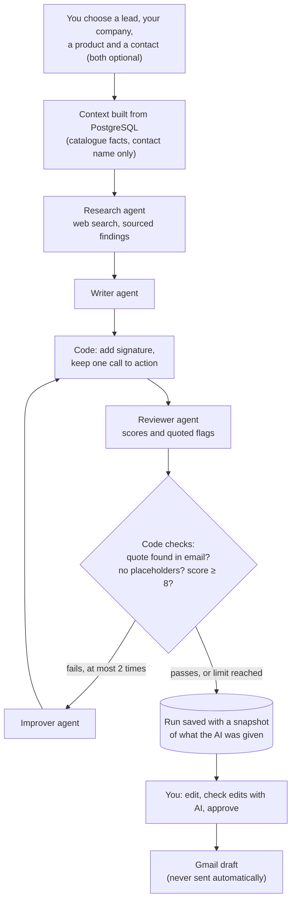

# AI Outreach Platform

A human-in-the-loop B2B outreach assistant built with the **OpenAI Agents SDK**.
AI agents research a target company, write a personalised email and check it against the evidence.
A person then edits and approves the email, and the app saves it as a **Gmail draft**. Nothing is ever sent automatically.

**Stack:** Python · FastAPI · OpenAI Agents SDK · PostgreSQL · SQLAlchemy · Alembic · React · TypeScript · Tailwind CSS · Gmail API


## What it does

1. **My Company:** describe what you sell and add your products, plus your signature and how emails should end (a phone call or an email reply).
2. **Leads:** add companies you want to reach and the role you are looking for.
3. **New draft:** pick a lead. Optionally, an agent matches the best product from your catalogue, and another searches public sources for a contact.
4. **Generate:** agents research the company, write the email, review it and rewrite it up to twice.
5. **Drafts:** read the review, edit the email, ask the AI to check your edits, approve it, and save it to Gmail.

## How the agents work



Two more agents support the first step: a **solution-matching agent** that may only recommend a product ID from your catalogue (the backend rejects any other ID), and a **contact-discovery agent** whose results are ranked and source-checked in Python.

All agents return typed, structured output (Pydantic models), so the backend never parses free text.

### Keeping the AI honest

| Rule | How it is enforced |
|---|---|
| Product claims come only from your catalogue | Facts are read from the database, never from the browser |
| The contact's job title is never stated as fact | Only the contact's name is given to the agents |
| A reviewer flag must quote the email | Code drops flags whose quote is not in the email, and shows them as "ignored" |
| No `[Your Name]`-style placeholders | Code check: always fails the review |
| The signature is always correct | Added by code from My Company, never written by the AI |
| A draft passes only with a score of 8 or more and no remaining flags | Code check |
| Approving a failed draft is a conscious decision | The API refuses unless you confirm, and records the override |
| Contact sources are checked | The page is fetched over HTTPS only (allowlisted sites and the lead's own website), with no redirects and a size limit |
| Gmail access is minimal | OAuth with PKCE and state checks, compose scope, drafts only |

## Screenshots

| New draft | My Company |
|---|---|
|  |  |

*Names and contact details in the screenshots are anonymised.*

## Run it locally

**You need:** Python 3.12, [uv](https://docs.astral.sh/uv/), Node.js 20.19+ or 22.12+, Docker Desktop, and an OpenAI API key.

```bash
# 1. Database (PostgreSQL 17 on 127.0.0.1:5433)
docker compose up -d

# 2. Backend: http://127.0.0.1:8000/docs
cd backend
cp .env.example .env              # then add your OPENAI_API_KEY
uv sync
uv run alembic upgrade head
uv run uvicorn app.main:app --reload

# 3. Frontend: http://localhost:5173 (in a second terminal)
cd frontend
npm install
npm run dev
```

On Windows PowerShell, use `Copy-Item .env.example .env` instead of `cp`.

**Gmail (optional).** In Google Cloud, enable the Gmail API and create an OAuth client of type *Web application*. Add `http://127.0.0.1:8000/api/v1/gmail/callback` as a redirect URI, put the client ID and secret in `backend/.env`, then click **Connect Gmail** in the app. Without these steps, everything except Gmail still works.

**First use:** add your company, a product and your signature in **My Company**, add a lead in **Leads**, then open **New draft**.

## Tests

Agent and Gmail calls are mocked, so the tests cost nothing and need no API keys.

```bash
docker exec ai-outreach-db createdb -U outreach outreach_test_db   # once

cd backend
uv run ruff check .
uv run python -m pytest            # 98 tests

cd ../frontend
npm run lint
npm run build
```

The tests cover the agent workflow and the reviewer guardrails. They also include API integration tests for context building, product ownership, approval rules, run numbering, and lead editing and deletion. Other tests check that Gmail drafts require human approval.

## Project structure

```
backend/
  app/agents/       research, writer, reviewer, improver, matching, contact discovery
  app/workflows/    the outreach pipeline and its code checks
  app/services/     database logic, source checks, Gmail
  app/api/routes/   FastAPI endpoints
  alembic/          database migrations
  test/             pytest suite
frontend/src/
  pages/            Dashboard, My Company, Leads, New draft, Drafts
  components/       shared UI and review components
docs/screenshots/
```

## Security

- `backend/.env` and `frontend/.env` are git-ignored. Only `.env.example` files with placeholders are committed.
- Gmail OAuth tokens are stored outside the project folder (`%LOCALAPPDATA%\ai-outreach-platform` on Windows, your home folder elsewhere).
- The database password in `compose.yaml` is for local development only. The port is bound to `127.0.0.1`.

## Limitations and next steps

This is an MVP: one user, no login, and generation runs inside the web request (about 15–30 seconds).
Contact discovery is best-effort, and every contact must be reviewed by a person.
Before any commercial use, finding contacts and sending cold emails must comply with UK GDPR and PECR.

**Next:** GitHub Actions CI · Docker images · Terraform deployment · background jobs · agent tracing and cost tracking · an evaluation set for draft quality.
