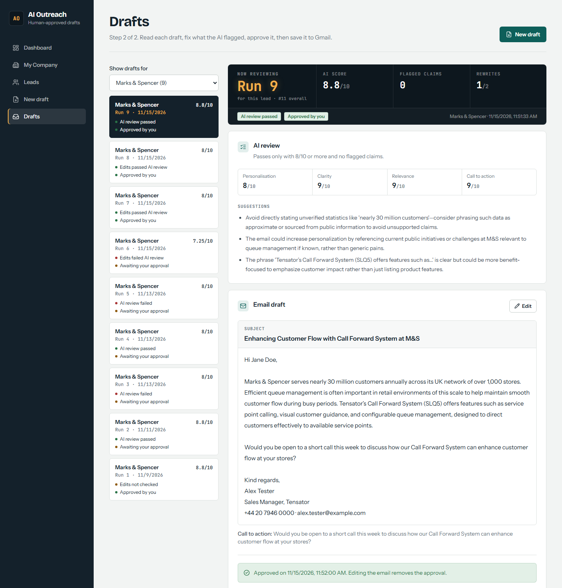
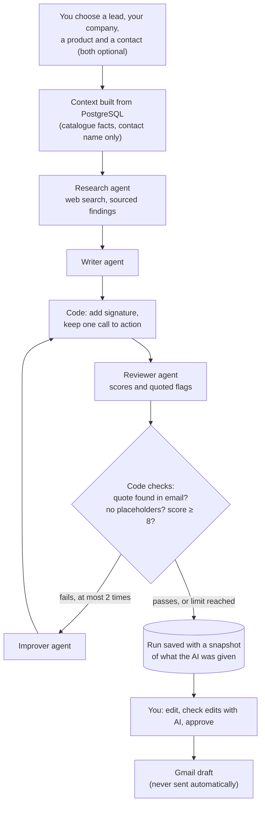
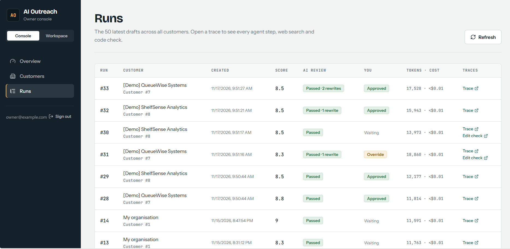
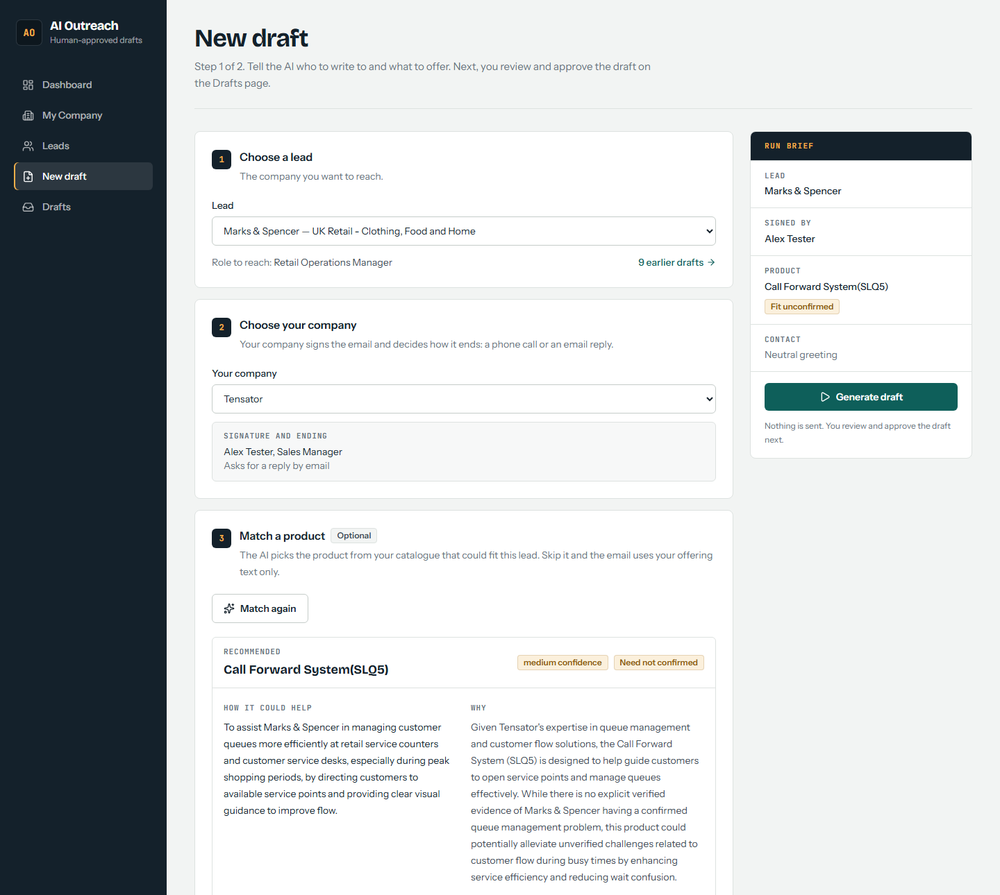
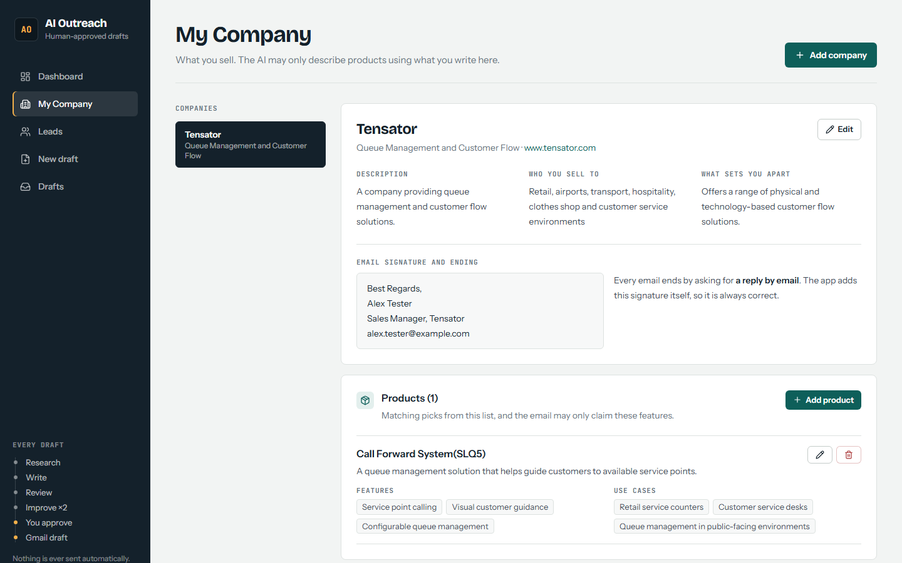

# AI Outreach Platform

A human-in-the-loop B2B outreach assistant built with the **OpenAI Agents SDK**.
AI agents research a target company, write a personalised email and check it against the evidence.
A person then edits and approves the email, and the app saves it as a **Gmail draft**. Nothing is ever sent automatically.

**Stack:** Python · FastAPI · OpenAI Agents SDK · PostgreSQL · SQLAlchemy · Alembic · Supabase Auth · React · TypeScript · Tailwind CSS · Gmail API



## What it does

0. **Sign in:** each account has its own companies, leads, drafts and Gmail connection.
1. **My Company:** describe what you sell and add your products, plus your signature and how emails should end (a phone call or an email reply).
2. **Leads:** add companies you want to reach and the role you are looking for.
3. **New draft:** pick a lead. Optionally, an agent matches the best product from your catalogue, and another searches public sources for a contact.
4. **Generate:** agents research the company, write the email, review it and rewrite it up to twice.
5. **Drafts:** read the review, edit the email, ask the AI to check your edits, approve it, and save it to Gmail.

## How the agents work



Two more agents support the first step: a **solution-matching agent** that may only recommend a product ID from your catalogue (the backend rejects any other ID), and a **contact-discovery agent** that runs three focused searches in parallel: the company's leadership pages, appointment news and trade press. Traces showed that a single run usually stops after one web search, so the code makes sure the search is broad. Python then merges, de-duplicates, ranks and source-checks the results, and rejects anything that is not a named person, such as "Customer Service Team".

All agents return typed, structured output (Pydantic models), so the backend never parses free text.

### Keeping the AI honest

| Rule | How it is enforced |
|---|---|
| Product claims come only from your catalogue | Facts are read from the database, never from the browser |
| The contact's job title is never stated as fact | Only the contact's name is given to the agents |
| A reviewer flag must quote the email | Code drops flags whose quote is not in the email, and shows them as "ignored" |
| No `[Your Name]`-style placeholders | Code check: always fails the review |
| The signature is always correct | Added by code from My Company, never written by the AI |
| A draft passes only with a score of 8 or more and no remaining flags | Code check |
| Approving a failed draft is a conscious decision | The API refuses unless you confirm, and records the override |
| Contact sources are checked | The page is fetched over HTTPS only (allowlisted sites and the lead's own website), with no redirects and a size limit |
| Each account sees only its own data | One login check (`get_current_user`) on every route, and every query filters by organisation. Other accounts' records return 404 |
| Gmail access is minimal | OAuth with PKCE and state checks, compose scope, drafts only. Tokens are stored per user, encrypted |

### Tracing and cost

Agents are non-deterministic, so every draft is recorded as **one trace** in the OpenAI Traces dashboard. The trace shows each agent call, web search, model response and timing. It also shows the decisions made by code: which reviewer flags were dropped, whether the review passed, and whether code changed the signature or call to action.

- The trace id is saved on the run. Traces, tokens and costs are **owner data**: customers never see them, and the API does not return them to customers.
- An AI check of your edits gets its own trace in the same group as the draft.
- Every run stores its token usage and an estimated cost. Per-account usage limits can later build on this.

### Owner Console

Product owners (accounts listed in `ADMIN_EMAILS`) start in a separate **Owner Console**, and can switch to their own workspace at any time. The console has three pages:

- **Overview:** customers, drafts and model cost. It also shows AI quality (pass rate, passes without a rewrite, average score) and how often code and people stepped in: reviewer flags dropped by code, placeholders, missing signatures, human edits and approvals that override a failed review.
- **Customers:** usage and cost per customer, with each customer's runs.
- **Runs:** the latest runs of every customer, each linked to its trace.

The console shows usage, never email content. For everyone else, the owner routes return 404.


| Customers | Runs |
|---|---|
|  |  |

*The `[Demo]` customers were created by the simulation script (below). Email addresses are anonymised.*
- `TRACE_INCLUDE_SENSITIVE_DATA=false` keeps email text and names out of traces.
- Tests disable tracing, so they never send data to OpenAI.

The SDK's built-in tracing needs no extra infrastructure. Because the SDK supports trace processors, Langfuse or OpenTelemetry can be added later without changing the workflow code.

## Screenshots

| New draft | My Company |
|---|---|
|  |  |

*Names and contact details in the screenshots are anonymised.*

## Run it locally

**You need:** Python 3.12, [uv](https://docs.astral.sh/uv/), Node.js 20.19+ or 22.12+, Docker Desktop, an OpenAI API key and a free [Supabase](https://supabase.com) project (used only for login).

```bash
# 1. Database (PostgreSQL 17 on 127.0.0.1:5433)
docker compose up -d

# 2. Backend: http://127.0.0.1:8000/docs
cd backend
cp .env.example .env              # then fill in the values
uv sync
uv run alembic upgrade head
uv run uvicorn app.main:app --reload

# 3. Frontend: http://localhost:5173 (in a second terminal)
cd frontend
cp .env.example .env              # Supabase URL and publishable key
npm install
npm run dev
```

On Windows PowerShell, use `Copy-Item .env.example .env` instead of `cp`.

**Supabase (login).** Create a project. In **Authentication → URL Configuration**, set the Site URL to `http://localhost:5173` and add `http://localhost:5173/**` as a redirect URL. Copy the Project URL into both `.env` files and the publishable key into `frontend/.env`. The backend checks tokens with the project's public signing keys, so no Supabase secret is stored anywhere.

**Gmail (optional).** In Google Cloud, enable the Gmail API and create an OAuth client of type *Web application*. Add `http://127.0.0.1:8000/api/v1/gmail/callback` as a redirect URI, put the client ID and secret in `backend/.env`, then click **Connect Gmail** in the app. Without these steps, everything except Gmail still works.

**First use:** create an account and confirm your email, then add your company, a product and your signature in **My Company**, add a lead in **Leads**, then open **New draft**.

**Health checks:** `GET /api/v1/health` reports that the server is running. `GET /api/v1/health/ready` also checks the database and returns 503 when it is unreachable.

## Simulating customers

`backend/scripts/simulate_customers.py` creates demo customers, each with its own seller company, products, signature and leads. Ten of the leads are real public companies and two are fictional. The script then drives the same route functions the browser uses, with the **real agents**: product matching, contact discovery, draft generation, a human edit that adds an unsupported claim, the AI check of that edit, and approval. The results appear in the Owner Console and in the traces.

```bash
cd backend
uv run python -m scripts.simulate_customers --customers 1 --leads 1   # smoke test
uv run python -m scripts.simulate_customers                            # 4 customers, 12 drafts
uv run python -m scripts.simulate_customers --cleanup                  # delete all demo data
```

Demo customers are named `[Demo] …` and cannot sign in. A full run costs well under $1 in model tokens, plus web search fees.

## Evaluating the Reviewer

The Reviewer decides whether a draft passes, so its judgement is measured, not assumed. `backend/evals/reviewer_cases.py` holds **30 fixed cases with known answers**, set at a fictional pharmacy chain so the model can only use the evidence it is given:

- 16 emails with one planted problem: an invented statistic, customers, award or certification; the recipient's job title; a past meeting that never happened; a wrong number; a feature or integration not in the catalogue; stronger wording than the evidence; a placeholder.
- 14 emails whose extra sentence the evidence supports: rounded numbers, catalogue features, research facts and hedged benefits.

The script runs the real Reviewer and the real code checks on every case, three times:

```bash
cd backend
uv run python -m scripts.evaluate_reviewer                     # about 35 s, about $0.10
uv run python -m scripts.evaluate_reviewer --model gpt-4.1     # compare another model
uv run python -m scripts.evaluate_reviewer --min-catch 0.75 --max-false-alarm 0.1   # fails below the bar
```

| Reviewer | Problems caught | False alarms | Same result in all 3 runs |
|---|---|---|---|
| Before (gpt-4.1-mini) | 60% | 0% | 23 / 30 |
| **After** (gpt-4.1-mini) | **81%** | **0%** | **30 / 30** |
| gpt-4.1, same prompt | 94% | 52% | 29 / 30 |

What changed:

- The Reviewer checks sentence by sentence, and wording stronger than the evidence counts as unsupported.
- It runs at temperature 0.
- It no longer sees the code-added signature. The evaluation found it flagging the sender's own job title.
- All agents now receive today's date, so a launch "in 2026" can be called recent.

The prompt's examples are deliberately different from the test cases, so the score measures generalisation rather than memorised answers.

The larger model caught more problems but rejected half of the correct emails, so gpt-4.1-mini stays. The remaining misses are subtle overstatements: "integrates seamlessly" for "works alongside", "in a single day" for "under a week", and a named EPOS integration. A person still reviews every email.

## Tests

Agent and Gmail calls are mocked, so the tests cost nothing and need no API keys.

```bash
docker exec ai-outreach-db createdb -U outreach outreach_test_db   # once

cd backend
uv run ruff check .
uv run python -m pytest            # 146 tests

cd ../frontend
npm run lint
npm run build
```

The tests cover the agent workflow and the reviewer guardrails. They also include API integration tests for context building, product ownership, approval rules, run numbering, and lead editing and deletion. Other tests check that Gmail drafts require human approval and that forged, expired or wrong-project login tokens are rejected. They also check that one account can never read, change or approve another account's records, or run agents on them.

## Project structure

```
backend/
  app/agents/       research, writer, reviewer, improver, matching, contact discovery
  app/workflows/    the outreach pipeline and its code checks
  app/services/     database logic, source checks, Gmail
  app/api/routes/   FastAPI endpoints
  scripts/          customer simulation and the Reviewer evaluation
  evals/            fixed evaluation cases with known answers
  alembic/          database migrations
  test/             pytest suite
frontend/src/
  pages/            Dashboard, My Company, Leads, New draft, Drafts, Owner Console
  components/       shared UI and review components
docs/screenshots/
```

## Security

- `backend/.env` and `frontend/.env` are git-ignored. Only `.env.example` files with placeholders are committed.
- Login is handled by Supabase Auth. The backend never sees passwords. It checks each request's token: signature, expiry, audience and issuer.
- Gmail OAuth tokens are stored per user in PostgreSQL, encrypted with `TOKEN_ENCRYPTION_KEY`.
- The database password in `compose.yaml` is for local development only. The port is bound to `127.0.0.1`.
- CORS allows `localhost` for development and only the addresses listed in `CORS_ORIGINS` once deployed.

## Limitations and next steps

This is an MVP: one user per organisation (no teams or roles yet), no password reset page yet, and generation runs inside the web request (about 15–30 seconds).
It runs locally only: the app and the confirmation emails point to `localhost`, so other people can sign up but cannot use it until it is deployed.
Every account uses the server's OpenAI key, so before deploying, turn off public sign-ups in Supabase and invite testers, or add per-account usage limits.
Contact discovery is best-effort, and every contact must be reviewed by a person.
Before any commercial use, finding contacts and sending cold emails must comply with UK GDPR and PECR.

**Next:** GitHub Actions CI · Docker images · Terraform deployment · background jobs · per-account usage limits · Langfuse or OpenTelemetry export · an evaluation set for draft quality.
