# AI Outreach Platform

[](https://github.com/seyyednavid/ai-outreach-platform/actions/workflows/ci.yml)
[](https://github.com/seyyednavid/ai-outreach-platform/actions/workflows/deploy.yml)

A human-in-the-loop B2B outreach assistant built with the **OpenAI Agents SDK**. AI agents research a target company on the web, write a personalised email and review it against the evidence. Python code enforces the rules, a person edits and approves every email, and only then is it saved as a **Gmail draft**. Nothing is ever sent automatically.

**Live demo:** [ai-outreach-frontend-759154400090.europe-west2.run.app](https://ai-outreach-frontend-759154400090.europe-west2.run.app) (sign-in required) · **Walkthrough:** [demo video](#demo-video) · **Docs:** [Architecture](docs/ARCHITECTURE.md) · [Deployment](docs/DEPLOYMENT.md) · [E2E test report](docs/E2E_TEST_REPORT.md)

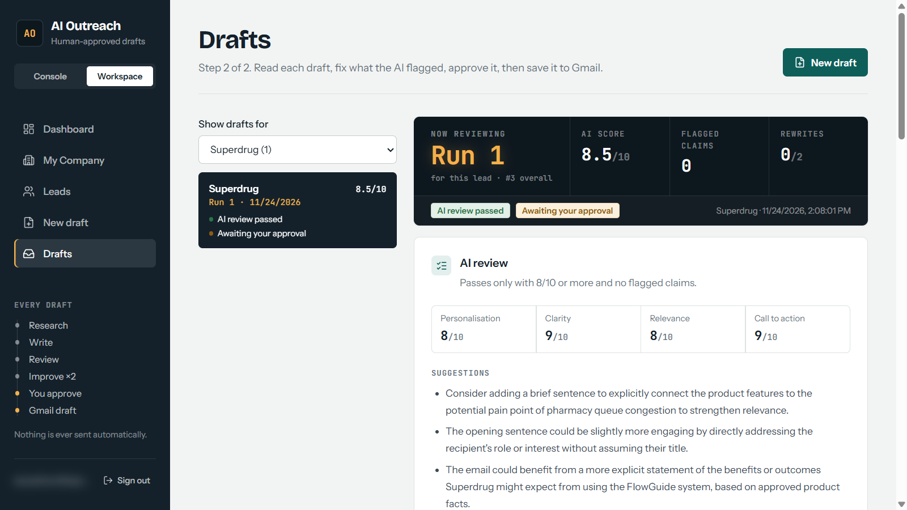

## Why it exists

Personalised B2B emails take time to research, and AI-written ones tend to invent facts: a statistic, a customer, the recipient's job title. This project treats the model as a fast but unreliable colleague:

- agents do the research and writing, and return **typed, structured output**;
- **code, not the model,** decides whether a draft passes;
- **a person** approves every email, and the app can only create drafts in their own Gmail.

It is a portfolio project running as a low-cost demo, not a commercial service.

## Highlights

- **Multi-agent workflow** with six agents: research (web search), writer, reviewer, improver, product matching and contact discovery. The improvement loop is bounded (at most two rewrites).
- **Guardrails enforced in Python:** reviewer flags must quote the email, placeholders always fail, product facts come only from the catalogue, and approving a failed draft needs an explicit override.
- **Measured, not assumed:** the Reviewer is evaluated on 30 fixed cases with known answers.
- **Multi-tenant SaaS basics:** Supabase login, JWT verification on every route, per-organisation data isolation, row-level security.
- **Production-style delivery:** Docker, Terraform, Google Cloud Run, GitHub Actions CI/CD with Workload Identity Federation (no stored cloud keys), Secret Manager, structured JSON logs and Cloud Monitoring alerts.

## How it works

1. **My Company:** describe what you sell, add products, and set your signature and how emails should end.
2. **Leads:** add companies to contact and the role you want to reach.
3. **New draft:** pick a lead. Optionally, an agent picks the best product from your catalogue and another searches public sources for a named contact.
4. **Generate:** agents research the company, write the email, review it and, if needed, improve it.
5. **Drafts:** read the review, edit the email, ask the AI to re-check your edits, approve, and save it to Gmail.

| New draft | My Company |
|---|---|
| 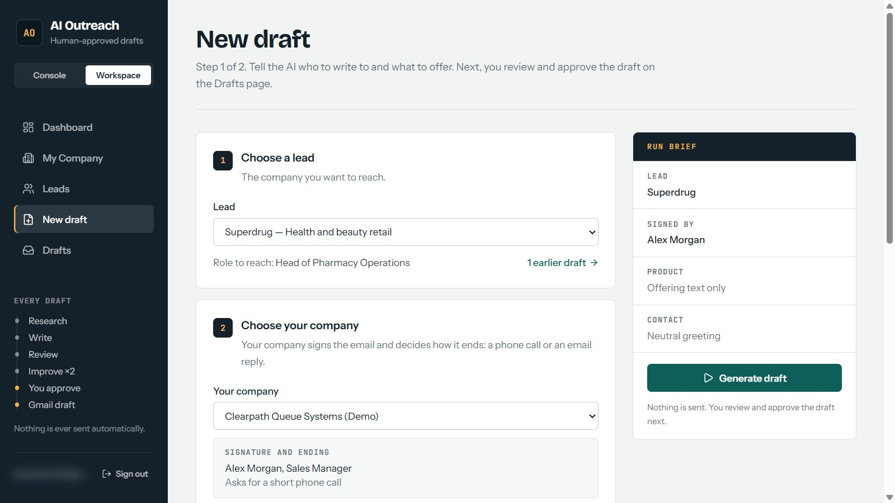 | 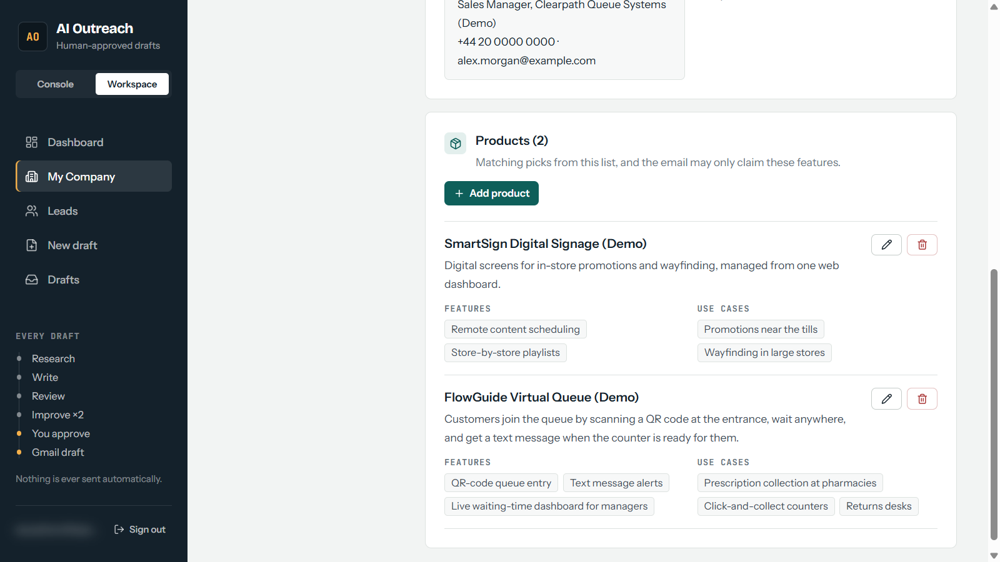 |

*Names and contact details in the screenshots are anonymised.*

## Demo video

[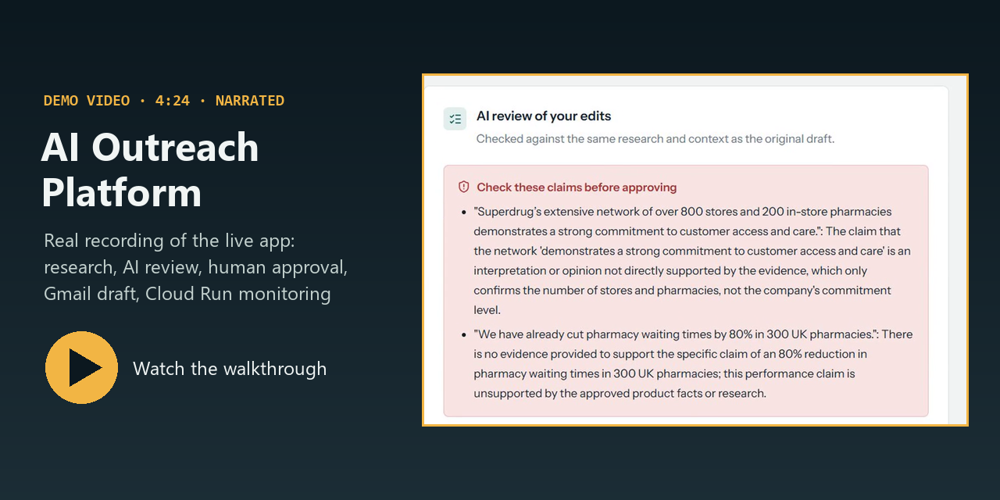](https://github.com/seyyednavid/ai-outreach-platform/releases/tag/v1.0.0)

**[Watch the 4½-minute narrated walkthrough](https://github.com/seyyednavid/ai-outreach-platform/releases/tag/v1.0.0)** ([download the MP4](https://github.com/seyyednavid/ai-outreach-platform/releases/download/v1.0.0/ai-outreach-demo.mp4), 34 MB): a real recording of the deployed app. A fictional seller researches a real company (Superdrug, via its website); the agents match a product, find sourced contacts and draft an email; one research figure turns out not to be on its cited page, which is why a person checks sources; a human edit with an invented statistic is flagged and approval is blocked until every claim is fixed; the approved draft is then opened in Gmail. It ends with the Owner Console, the architecture, CI/CD, and Cloud Monitoring and Logging, including this demo's own requests and OpenAI calls in the logs. Timings and narration: [docs/DEMO_SCRIPT.md](docs/DEMO_SCRIPT.md).

Screens from that run (24 Nov 2026, see the [E2E test report](docs/E2E_TEST_REPORT.md)):

| Product matching | Contact discovery (names blurred) | Research with sources (one needs checking) |
|---|---|---|
| 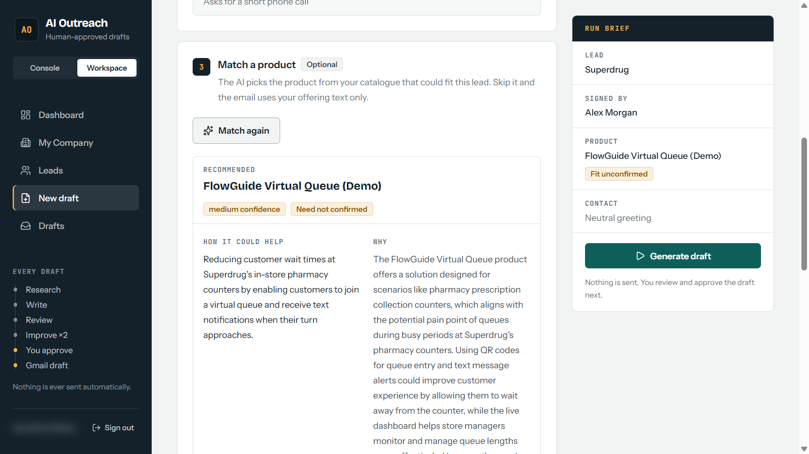 | 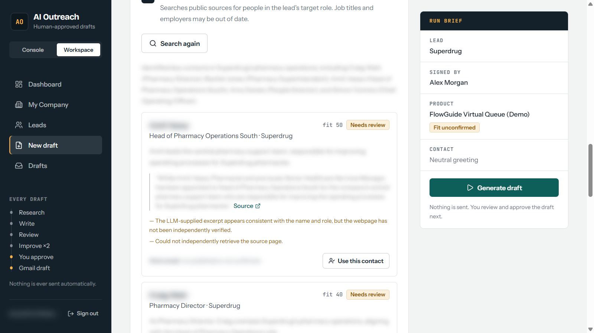 | 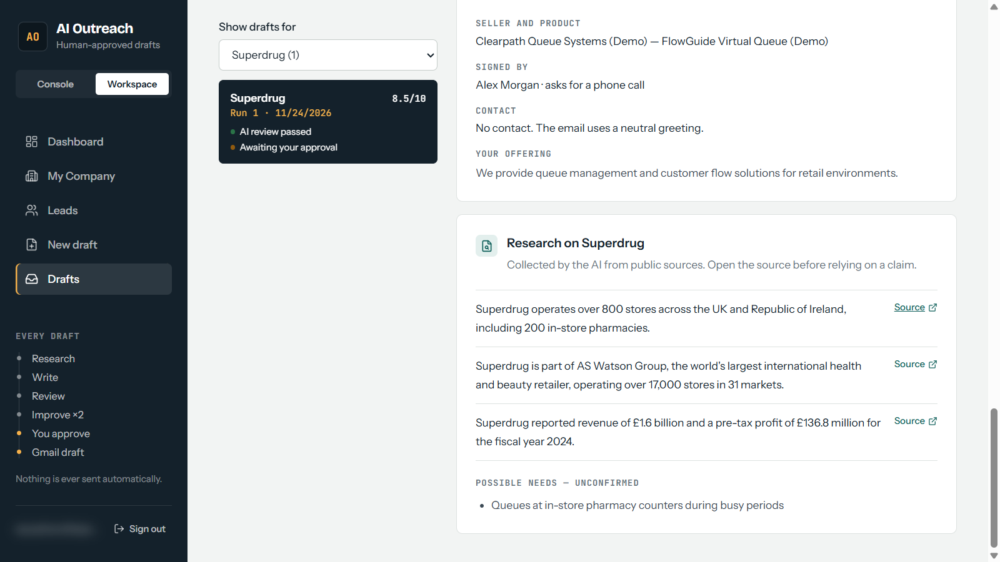 |
| **Reviewer flags unsupported claims** | **Approval blocked while flagged** | **The approved draft in Gmail** |
| 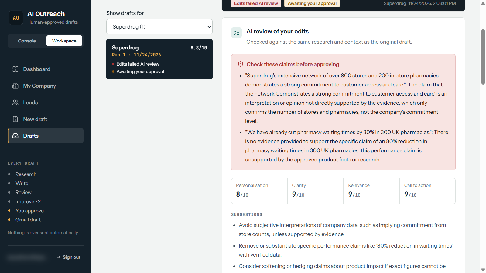 | 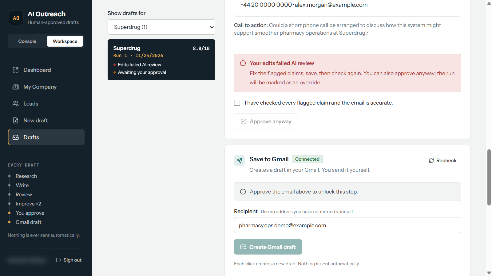 | 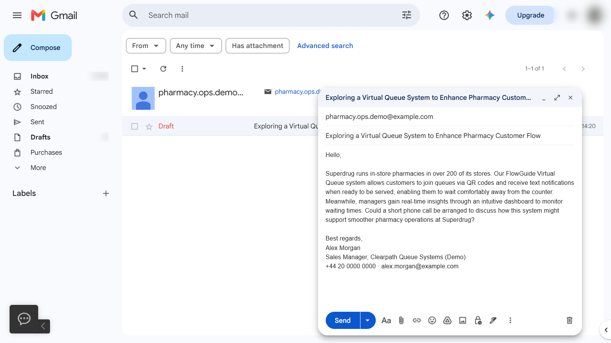 |

## Multi-agent workflow

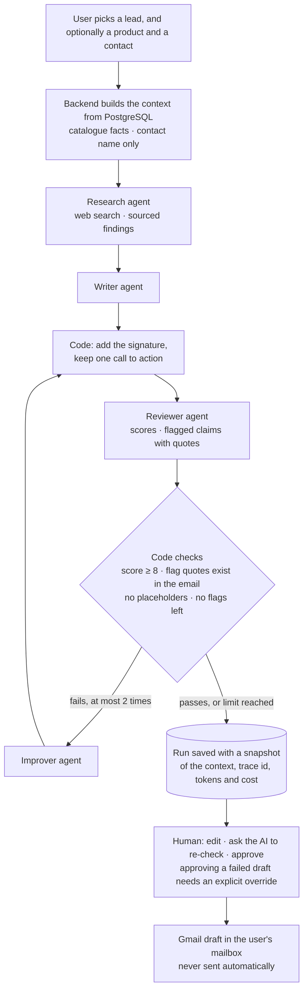

**What the AI recommends:** research findings with sources, the email text, review scores, flagged claims with quotes, a product choice, candidate contacts.

**What the backend enforces:**

| Rule | How |
|---|---|
| Product claims come only from your catalogue | Facts are read from the database; a product ID outside the catalogue is rejected |
| The contact's job title is never stated as fact | Only the contact's name reaches the agents |
| A reviewer flag must quote the email | Flags whose quote is not in the email are dropped and shown as "ignored" |
| No `[Your Name]`-style placeholders | Always fails the review |
| The signature is correct | Added by code from My Company, never written by the AI |
| A draft passes only with score ≥ 8 and no remaining flags | Code check; the reviewer's own `approved` field is stored but not used |
| Improvement is bounded | At most two improver runs, each followed by a new review |
| Approving a failed draft is deliberate | The API refuses unless you confirm, and records the override |
| Gmail is a separate, human step | Drafts require approval; OAuth uses PKCE and a drafts-only scope |

Agents run through the SDK's `Runner` with typed `output_type` models; research and contact discovery use the hosted web search tool. Contact discovery runs three focused searches in parallel, then Python merges, de-duplicates, ranks and source-checks the results. Every draft is **one trace** in the OpenAI Traces dashboard, including the code's decisions; traces exclude prompts and email text in production.

### Reviewer evaluation

The Reviewer decides whether a draft passes, so it is measured. [`backend/evals/reviewer_cases.py`](backend/evals/reviewer_cases.py) holds 30 cases at a fictional company: 16 emails with one planted problem (an invented statistic, customer or award, the recipient's job title, a feature not in the catalogue, a placeholder…) and 14 emails whose extra sentence the evidence supports. The script runs the real Reviewer and the real code checks three times per case.

| Reviewer | Problems caught | False alarms | Same result in all 3 runs |
|---|---|---|---|
| Before prompt changes (gpt-4.1-mini) | 60% | 0% | 23 / 30 |
| **Current** (gpt-4.1-mini), re-run 24 Nov 2026 | **81%** | **0%** | **28 / 30** |
| gpt-4.1, same prompt | 94% | 52% | 29 / 30 |

The larger model caught more problems but rejected half of the correct emails, so gpt-4.1-mini stays, and a person still reviews every email. One run costs about $0.10 (measured: $0.097, 28.5 s). It also runs as a manual GitHub Actions workflow that fails below 75% caught or above 10% false alarms.

## Architecture

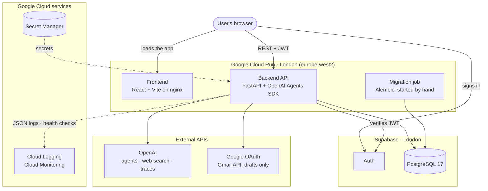

The delivery pipeline and component details are in [docs/ARCHITECTURE.md](docs/ARCHITECTURE.md).

## Tech stack

| Layer | Technologies |
|---|---|
| AI | OpenAI Agents SDK, gpt-4.1-mini, hosted web search, Pydantic structured outputs, OpenAI Traces |
| Backend | Python 3.12, FastAPI, SQLAlchemy 2, Alembic, PyJWT, Google API client, uv |
| Data and auth | PostgreSQL 17 (Supabase, row-level security), Supabase Auth |
| Frontend | React 19, TypeScript, Vite, Tailwind CSS 4, React Router 7 |
| Infrastructure | Docker, Google Cloud Run, Artifact Registry, Secret Manager, Terraform |
| CI/CD | GitHub Actions, Workload Identity Federation |
| Observability | Structured JSON logs in Cloud Logging, Cloud Monitoring uptime check and alerts, per-run token and cost tracking |

## Owner Console

Product owners (`ADMIN_EMAILS`) get a separate console showing usage, never email content: customers, drafts, model cost, AI quality (pass rate, passes without a rewrite, average score) and how often code and people stepped in. Each run links to its trace. For everyone else these routes return 404.

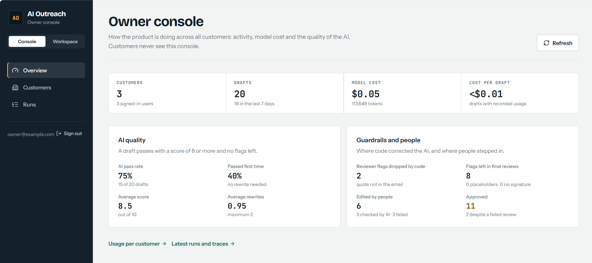

| Customers | Runs |
|---|---|
| 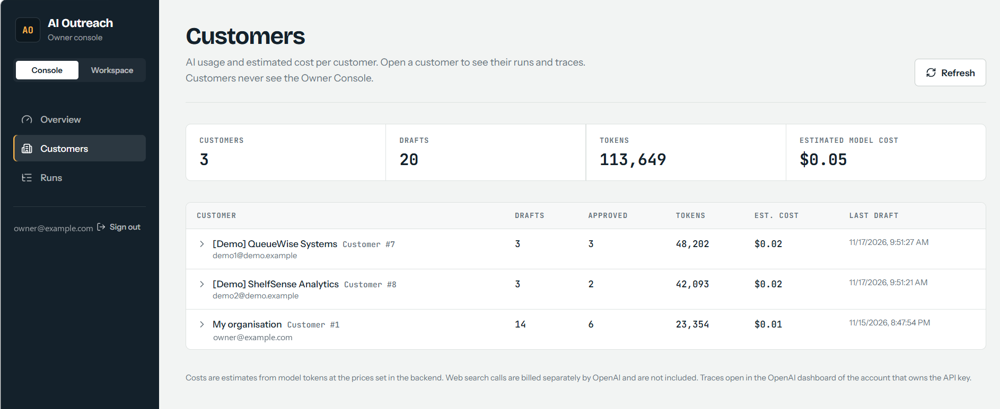 |  |

*The `[Demo]` customers were created by the simulation script. Email addresses are anonymised.*

## Deployment and CI/CD

A push to `main` runs **CI** (Ruff, 193 pytest tests, ESLint, type check, build, Docker builds). When it passes, **Deploy** builds both images from that commit, signs in to Google Cloud through **Workload Identity Federation**, pushes to Artifact Registry and rolls out new Cloud Run revisions, then checks both services. Only the image changes: settings, secrets, scaling and IAM stay as Terraform defined them. Database migrations are never automatic; CD updates the migration job's image and a person runs it.

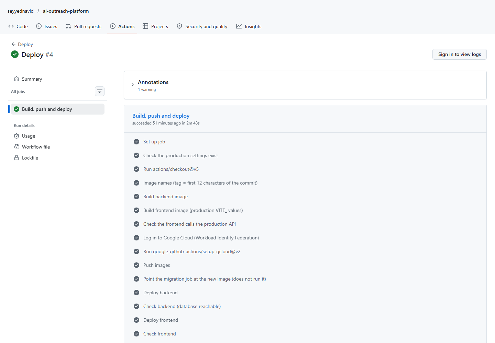

| CI run | Cloud Run, migration job and images |
|---|---|
| 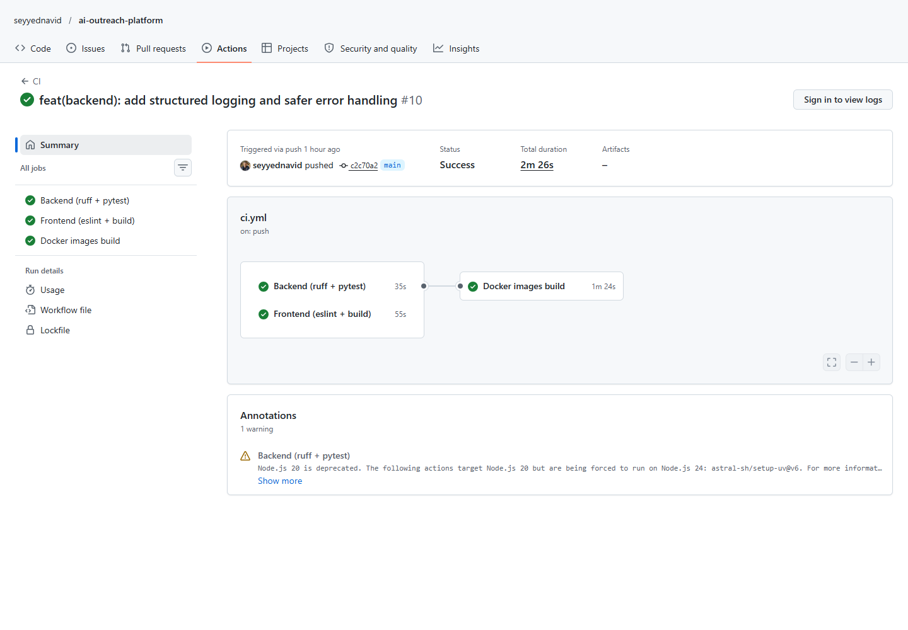 | 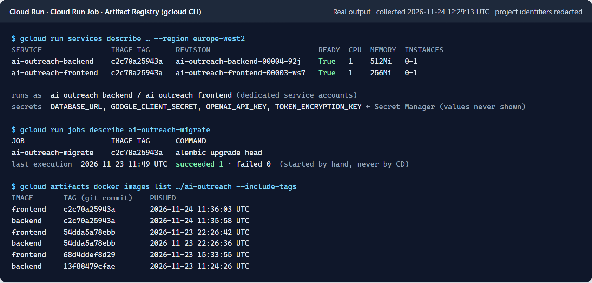 |

Terraform in [`infra/terraform`](infra/terraform) manages 37 Google Cloud resources: Cloud Run services and job, Artifact Registry, Secret Manager, service accounts with least-privilege IAM, Workload Identity Federation and monitoring. Details, IAM table, rollback and troubleshooting: [docs/DEPLOYMENT.md](docs/DEPLOYMENT.md).

## Logging and monitoring

- **Structured JSON logs:** on Cloud Run every log line is a JSON object with severity, logger and source location, and tracebacks stay in one entry. A redaction filter removes tokens, keys, OAuth codes and database passwords; AI errors are logged by type and location, never by message; SQL parameters are hidden.
- **Uptime check:** `GET /api/v1/health/ready` (API and database) every 5 minutes from three regions.
- **Alerts by email:** backend unavailable from two or more regions, or any 5xx response.

| Cloud Run metrics | Logs Explorer: one "Generate draft" and its three OpenAI calls |
|---|---|
| 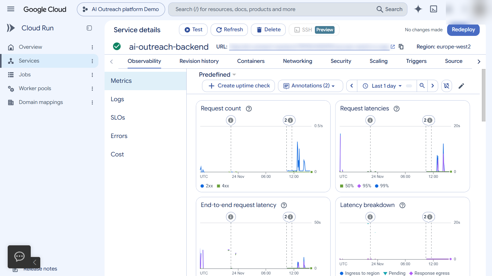 | 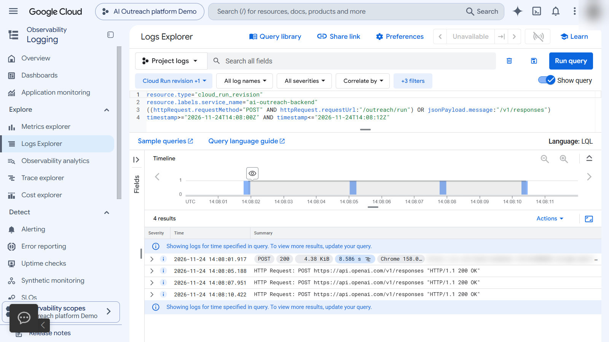 |
| **Uptime check** | **Alert policies** |
| 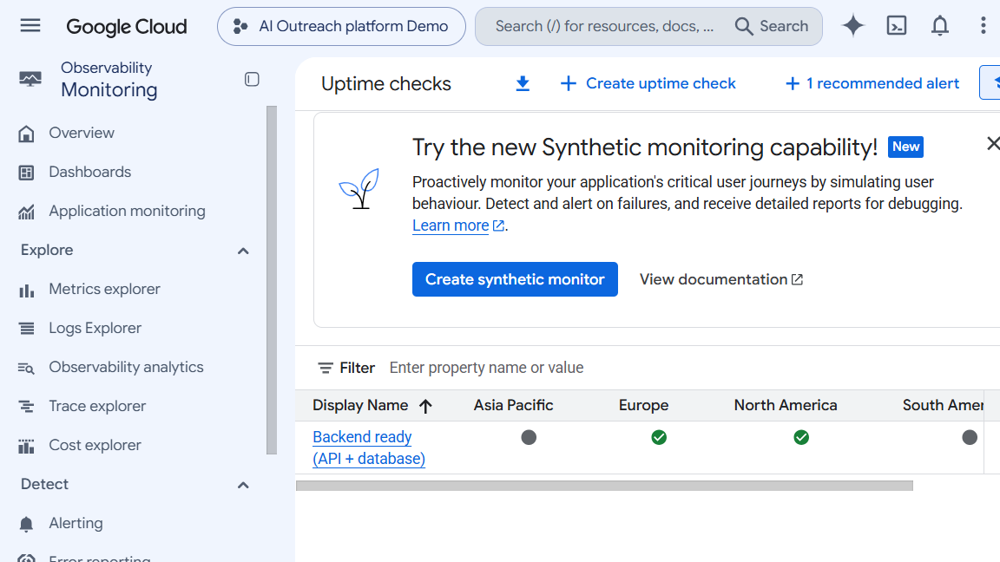 | 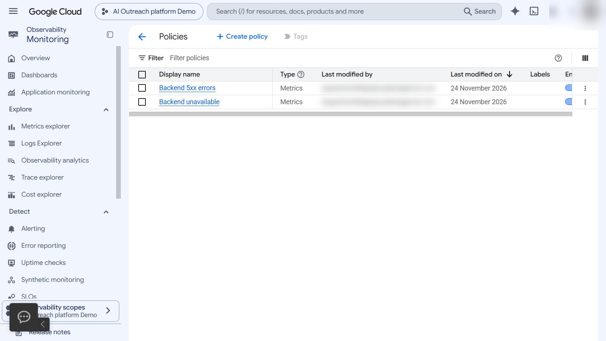 |

More from the demo run: [its POST/PUT requests](docs/assets/screenshots/gcp-console-logs.png) (edits, AI re-checks, approval, Gmail draft) and [one request as a structured entry](docs/assets/screenshots/gcp-console-log-entry.png) (path, status, latency; client IP and service host blurred). An application log entry with severity, logger and source location is shown in [docs/DEPLOYMENT.md](docs/DEPLOYMENT.md#logging).

## Security

- **No stored cloud keys:** GitHub Actions uses Workload Identity Federation, limited to this repository, `main` and the `production` environment.
- **Least privilege:** each Cloud Run service has its own service account; the backend can read only its four secrets, and the frontend has no permissions. The deployer can push images and update revisions, but cannot read secrets or change IAM.
- **Secrets** live in Secret Manager and are never in images, Terraform or Git.
- **Authentication:** Supabase Auth; the backend checks each token's signature, expiry, audience and issuer, and every query filters by organisation. Other accounts' records return 404.
- **Database:** row-level security on every table blocks Supabase's public Data API; only the backend reads the data.
- **Gmail:** OAuth with PKCE and a one-time state, `gmail.compose` scope, drafts only; tokens are encrypted at rest.
- **Logs and traces** exclude tokens, OAuth codes, prompts and email text.
- **Containers:** the backend runs as a non-root user; scripts and evaluations are not in the production image.

## Run it locally

**You need:** Docker Desktop, an OpenAI API key and a free [Supabase](https://supabase.com) project (used for login).

```bash
cp backend/.env.example backend/.env       # then fill in the values
cp frontend/.env.example frontend/.env     # Supabase URL and publishable key
docker compose up --build                  # database, migrations, backend, frontend
```

Open **http://localhost:8080** (API docs: http://127.0.0.1:8000/docs). In Supabase, add `http://localhost:8080/**` to the redirect URLs.

<details>
<summary><b>Development setup without Docker for the app</b></summary>

**You need:** Python 3.12, [uv](https://docs.astral.sh/uv/), Node.js 20.19+ or 22.12+ and Docker Desktop (database only).

```bash
docker compose up -d db                   # PostgreSQL 17 on 127.0.0.1:5433

cd backend
cp .env.example .env                      # then fill in the values
uv sync
uv run alembic upgrade head
uv run uvicorn app.main:app --reload      # http://127.0.0.1:8000/docs

cd ../frontend                            # in a second terminal
cp .env.example .env
npm install
npm run dev                               # http://localhost:5173
```

On Windows PowerShell, use `Copy-Item .env.example .env` instead of `cp`.

**Supabase:** in Authentication → URL Configuration, set the Site URL to `http://localhost:5173` and add `http://localhost:5173/**` as a redirect URL. The backend checks tokens with the project's public signing keys, so no Supabase secret is stored.

**Gmail (optional):** enable the Gmail API in Google Cloud, create an OAuth client of type *Web application*, add `http://127.0.0.1:8000/api/v1/gmail/callback` as a redirect URI, and put the client ID and secret in `backend/.env`. Everything except Gmail works without this.

**Demo data:** `uv run python -m scripts.simulate_customers` creates `[Demo]` customers and drives the real agents through the same route functions the browser uses (`--cleanup` removes them).

</details>

## Testing

```bash
docker exec ai-outreach-db createdb -U outreach outreach_test_db   # once

cd backend
uv run ruff check .
uv run pytest                     # 193 tests

cd ../frontend
npm run lint
npm run build
```

Agent, OpenAI and Gmail calls are mocked, so the tests cost nothing and need no API keys. They cover the agent workflow and its guardrails, API integration (context building, product ownership, approval rules, run numbering), Gmail draft rules, token verification (forged, expired or wrong-project tokens), tenant isolation, row-level security coverage, structured logging and redaction, and Gmail OAuth failure handling.

Reviewer evaluation (calls OpenAI, about $0.10): `uv run python -m scripts.evaluate_reviewer`.

**End-to-end on the deployed app:** two Playwright-driven runs through the real UI, Gmail and Google Cloud Console (demo data, product matching, contact discovery, generation, flagged human edits, blocked approval, approval and a Gmail draft opened in Gmail) passed; results, timings and findings, including a mis-cited research figure and Reviewer non-determinism, are in the [E2E test report](docs/E2E_TEST_REPORT.md).

## Project structure

```
backend/
  app/agents/        research, writer, reviewer, improver, matching, contact discovery
  app/workflows/     the outreach pipeline and its code checks
  app/services/      database logic, source checks, Gmail
  app/api/routes/    FastAPI endpoints
  app/core/          settings, auth, database, logging, tracing
  alembic/           database migrations
  evals/ scripts/    Reviewer evaluation cases, evaluation and simulation scripts
  test/              pytest suite
frontend/src/        pages, components and API client (React + TypeScript)
infra/terraform/     Google Cloud infrastructure
.github/workflows/   CI, Deploy and Reviewer evaluation
docs/                architecture, deployment, E2E report, demo script, portfolio notes, assets
```

## Limitations and next steps

- One user per organisation (no teams or roles yet) and no password-reset page.
- Generation runs inside the web request; a background job queue is the natural next step.
- Gmail OAuth state is kept in memory, so the backend runs as a single instance.
- Contact discovery is best-effort, and every contact must be reviewed by a person.
- Research can confuse companies with similar names when a lead has no website; adding the website gives the agent an unambiguous target (see the E2E report).
- Every account uses the server's OpenAI key; per-account usage limits would be needed before wider use.
- Finding contacts and sending cold emails must comply with UK GDPR and PECR before any commercial use.

**Next:** background jobs · per-account usage limits · an evaluation set for draft quality · Langfuse or OpenTelemetry export.
