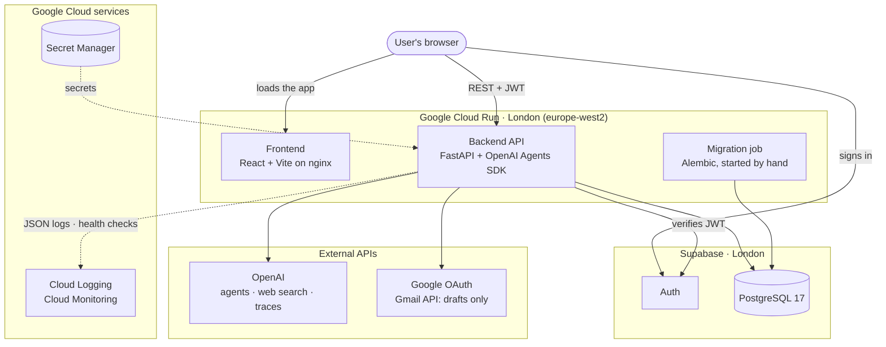
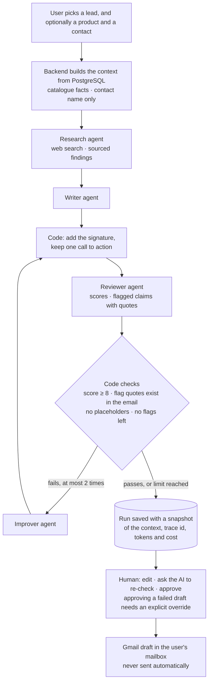
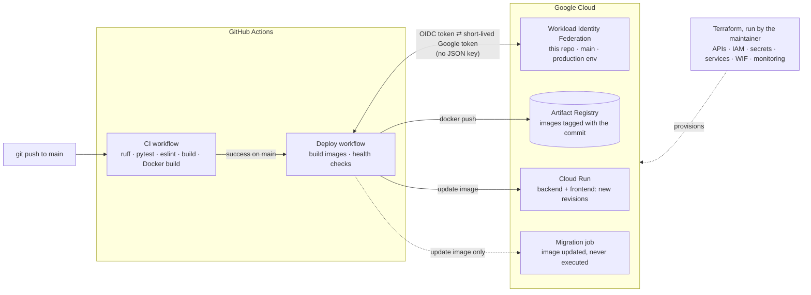

# Architecture

This document describes the system as it is implemented in this repository. Three diagrams cover the runtime architecture, the agent workflow and the delivery pipeline. They are written in Mermaid, so GitHub renders them directly and they can be edited as text.

- [Runtime architecture](#runtime-architecture)
- [Agent workflow](#agent-workflow)
- [Delivery pipeline](#delivery-pipeline)
- [Components](#components)
- [Design decisions](#design-decisions)

## Runtime architecture

The browser talks to three things: the static frontend, Supabase Auth (sign in) and the backend API, sending the Supabase access token as a Bearer token. Only the backend talks to the database, OpenAI and Gmail.

## Agent workflow

Two more agents run before this flow, when the user asks for them on the New draft page:

- **Solution matching agent:** recommends one product from the seller's catalogue. The backend rejects any product id that is not in that catalogue.
- **Contact discovery agent:** runs three focused web searches in parallel (leadership pages, appointment news, trade press). Python then merges, de-duplicates, ranks and source-checks the results.

The improver step is conditional: a draft that passes the code checks on the first review is saved without it.

## Delivery pipeline

Terraform owns the infrastructure and its settings. The Deploy workflow owns only which image runs: Terraform ignores image changes, so a later `terraform apply` never rolls a deployment back.

## Components

| Component | Implementation |
|---|---|
| Frontend | React 19, TypeScript, Vite, Tailwind CSS 4, React Router 7. Built into static files and served by nginx (multi-stage Docker image). |
| Backend | FastAPI, Pydantic, SQLAlchemy 2, Alembic. One process (uvicorn) per Cloud Run instance. |
| Agents | OpenAI Agents SDK, `gpt-4.1-mini`. Six agents with typed Pydantic outputs; research and contact discovery use the hosted web search tool. |
| Authentication | Supabase Auth in the browser. The backend verifies each JWT (signature via the project's public keys, expiry, audience, issuer) in one dependency, `get_current_user`. |
| Data | PostgreSQL 17 on Supabase. Every query is filtered by the user's organisation; row-level security blocks Supabase's public Data API. |
| Gmail | OAuth 2.0 with PKCE and a one-time state, `gmail.compose` scope. Refresh tokens are stored per user, encrypted with Fernet. |
| Hosting | Cloud Run services (scale 0 to 1), a Cloud Run Job for migrations, Artifact Registry, Secret Manager. |
| Delivery | GitHub Actions (CI and Deploy), Workload Identity Federation, Terraform. |
| Observability | OpenAI traces per draft (sensitive data off), token and cost per run, JSON logs in Cloud Logging, an uptime check and two email alerts in Cloud Monitoring. |

## Design decisions

- **The AI proposes, code decides.** The Reviewer's verdict is stored but not trusted: code checks that every flagged quote exists in the email, rejects placeholders and applies the score threshold. A person approves every email.
- **Bounded loops.** At most two improvements, so cost and latency are predictable.
- **Structured output everywhere.** Agents return Pydantic models, so the backend never parses free text.
- **Least privilege.** Each Cloud Run service has its own service account; the frontend's has no roles. The GitHub deployer can push images and roll out revisions, but cannot read secrets or change IAM.
- **No long-lived cloud keys.** GitHub Actions signs in through Workload Identity Federation.
- **Migrations are a deliberate step.** CD updates the migration job's image but never runs it.
- **Generation runs inside the request.** This keeps the MVP simple: a draft takes several agent calls in one request, and the backend's Cloud Run timeout is 10 minutes. A job queue is the next step for longer workloads.
