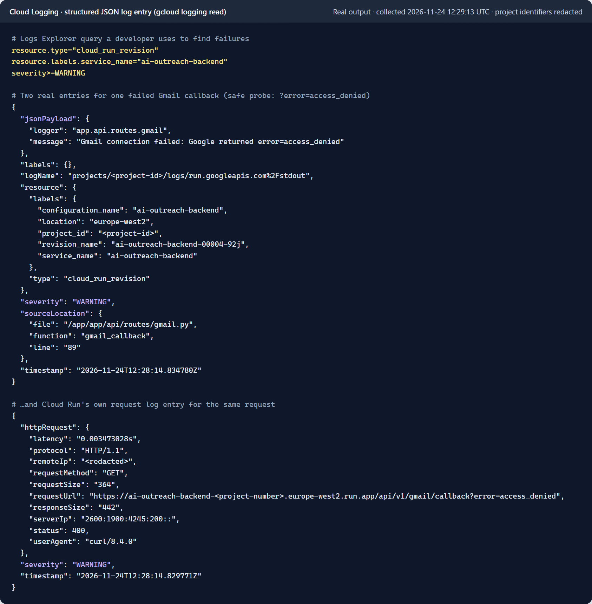
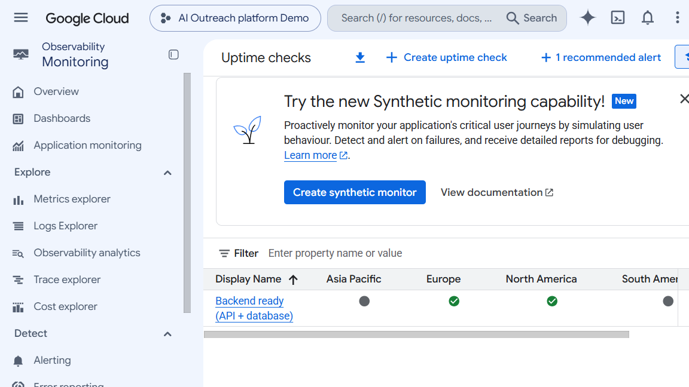

# Deployment and operations

How the AI Outreach Platform runs on Google Cloud, how a code change reaches production, and how to operate and troubleshoot it. Everything here matches the files in this repository. Values that identify the Google Cloud project are written as `<project-id>` and `<project-number>`; secret values never appear in the repository.

**Contents:** [Overview](#overview) · [How a change reaches Cloud Run](#how-a-change-reaches-cloud-run) · [Container images](#container-images) · [Terraform](#terraform) · [Identity and permissions](#identity-and-permissions) · [Secrets and configuration](#secrets-and-configuration) · [Database and migrations](#database-and-migrations) · [Health checks](#health-checks) · [Logging](#logging) · [Monitoring and alerting](#monitoring-and-alerting) · [First-time setup](#first-time-setup) · [Rollback](#rollback) · [Troubleshooting](#troubleshooting) · [Cost](#cost)

## Overview

| Piece | Where | Defined in |
|---|---|---|
| Frontend (React, nginx) | Cloud Run service `ai-outreach-frontend` | [`frontend/Dockerfile`](../frontend/Dockerfile), [`frontend_service.tf`](../infra/terraform/frontend_service.tf) |
| Backend (FastAPI, agents) | Cloud Run service `ai-outreach-backend` | [`backend/Dockerfile`](../backend/Dockerfile), [`backend_service.tf`](../infra/terraform/backend_service.tf) |
| Database migrations | Cloud Run Job `ai-outreach-migrate` | [`migrate_job.tf`](../infra/terraform/migrate_job.tf) |
| Images | Artifact Registry repository `ai-outreach` | [`artifact_registry.tf`](../infra/terraform/artifact_registry.tf) |
| Secrets | Secret Manager (4 secrets) | [`secrets.tf`](../infra/terraform/secrets.tf) |
| Database and login | Supabase (PostgreSQL 17 and Auth), London | Outside Terraform |
| CI and CD | GitHub Actions | [`ci.yml`](../.github/workflows/ci.yml), [`deploy.yml`](../.github/workflows/deploy.yml) |
| Keyless deploy access | Workload Identity Federation | [`github_actions.tf`](../infra/terraform/github_actions.tf) |
| Alerts | Cloud Monitoring | [`monitoring.tf`](../infra/terraform/monitoring.tf) |

Region: `europe-west2` (London). Both services scale from 0 to 1 instance. Diagrams: [ARCHITECTURE.md](ARCHITECTURE.md#delivery-pipeline).

## How a change reaches Cloud Run

1. **Push to `main`.** The [CI workflow](../.github/workflows/ci.yml) runs three jobs:
   - *Backend:* `ruff check`, `alembic upgrade head` on an empty PostgreSQL 17, then `pytest` (all external calls mocked, placeholder keys only).
   - *Frontend:* `eslint`, TypeScript check and production build.
   - *Docker:* both images build, only after the first two jobs pass.
2. **CI succeeds**, so the [Deploy workflow](../.github/workflows/deploy.yml) starts (`workflow_run`). It runs only for a successful `push` to `main` of this repository, never for pull requests, and only while the repository variable `CD_ENABLED` is `true`. The job uses the GitHub environment `production`, which allows only the `main` branch.
3. **Build.** It checks out the exact commit CI tested and builds both images, tagged with the first 12 characters of the commit. The frontend gets its public `VITE_*` values as build arguments, and a step checks that the built JavaScript calls the production API.
4. **Sign in to Google Cloud** through Workload Identity Federation (no JSON key). Images are built *before* this step, so build steps never hold cloud credentials.
5. **Push** both images to Artifact Registry.
6. **Point the migration job at the new backend image**, without running it.
7. **Deploy the backend** with `gcloud run services update --image`: only the image changes, so environment variables, secrets, scaling and IAM stay as Terraform set them. If the new revision fails its startup check, the old revision keeps serving.
8. **Check** `GET /api/v1/health/ready` (API and database), then **deploy the frontend** and check it.
9. A summary with the image names and the migration command is written to the run page.

The whole CD job takes about 3 minutes. One deployment runs at a time; a newer one waits instead of cancelling a rollout.

## Container images

**Backend** ([`backend/Dockerfile`](../backend/Dockerfile)):

- `python:3.12-slim-bookworm` with `uv` copied from its official image; dependencies installed with `uv sync --frozen --no-dev` from `uv.lock`, in their own layer for fast rebuilds.
- Runs as a non-root user (`appuser`, uid 1000).
- Contains only `app/`, `alembic/` and `alembic.ini`. Scripts, evaluations and tests stay out, so the demo-data simulation can never run against production.
- `CMD uvicorn app.main:app --host 0.0.0.0 --port 8000`. The migration job uses the same image with the command `alembic upgrade head`.

**Frontend** ([`frontend/Dockerfile`](../frontend/Dockerfile)), multi-stage:

1. `node:22-alpine`: `npm ci`, then `npm run build`. Production builds pass `VITE_API_BASE_URL`, `VITE_SUPABASE_URL` and `VITE_SUPABASE_PUBLISHABLE_KEY` as build arguments; without them (Docker Compose, CI) `frontend/.env` is used.
2. `nginx:1.27-alpine`: only the built files and [`nginx.conf`](../frontend/nginx.conf). Unknown paths return `index.html` (React Router), hashed assets are cached for a year, `index.html` is never cached, and `X-Content-Type-Options` and `Referrer-Policy` headers are set on every response.

The frontend image holds only public values. The Supabase publishable key is designed to be public; no secret or service-role key is ever built in.

## Terraform

All Google Cloud resources are in [`infra/terraform`](../infra/terraform) (provider `hashicorp/google ~> 7.0`). State is local to the maintainer's machine and git-ignored; CD never runs Terraform.

| File | Resources |
|---|---|
| `apis.tf` | Required APIs: Cloud Run, Artifact Registry, Secret Manager, IAM, STS, IAM Credentials, Monitoring |
| `artifact_registry.tf` | Docker repository `ai-outreach` |
| `service_accounts.tf` | `ai-outreach-backend`, `ai-outreach-frontend` |
| `secrets.tf` | 4 secrets and per-secret read access for the backend account |
| `backend_service.tf` | Backend service, its environment, probes, scaling, public access |
| `frontend_service.tf` | Frontend service, public access |
| `migrate_job.tf` | Migration job |
| `github_actions.tf` | WIF pool and provider, deployer account and its permissions |
| `monitoring.tf` | Email channel, uptime check, two alert policies |

Inputs go in `terraform.tfvars` (git-ignored); [`terraform.tfvars.example`](../infra/terraform/terraform.tfvars.example) shows every variable with placeholders.

**Images and Terraform stay consistent:** the services and the job have `lifecycle { ignore_changes = [image, client, client_version] }`. Terraform creates them with `backend_image_tag` / `frontend_image_tag`; afterwards the Deploy workflow owns the image, and `terraform apply` never rolls it back. To see what runs:

```bash
gcloud run services describe ai-outreach-backend --region europe-west2 \
  --format="value(spec.template.spec.containers[0].image)"
```

## Identity and permissions

| Identity | Permissions | Scope |
|---|---|---|
| `ai-outreach-backend` (runs the backend and the migration job) | `secretmanager.secretAccessor` | Each of the 4 secrets, nothing else |
| `ai-outreach-frontend` | none | nginx needs no Google access |
| `ai-outreach-deployer` (GitHub Actions) | `artifactregistry.writer` | The `ai-outreach` repository only |
| | `run.developer` | The two services and the migration job only (cannot change who may call them) |
| | `iam.serviceAccountUser` | The backend and frontend accounts, so new revisions can run as them |
| GitHub `production` environment of this repository | `iam.workloadIdentityUser` | The deployer account |
| `allUsers` | `run.invoker` | Both services: the browser calls them directly; the backend enforces login itself |

**Workload Identity Federation** accepts a GitHub token only if all of these hold:

- the provider condition: the repository's numeric ID, the owner's numeric ID, and `refs/heads/main`;
- the IAM binding: the exact subject of a job in the `production` environment. This repository uses GitHub's immutable subject format, `repo:OWNER@OWNER_ID/REPO@REPO_ID:environment:production`;
- on GitHub, the `production` environment only allows the `main` branch.

The deployer can push images and roll out revisions. It cannot read secrets, change IAM or delete services.

## Secrets and configuration

| Secret Manager secret | Environment variable |
|---|---|
| `database-url` | `DATABASE_URL` (Supabase Session pooler, `postgresql+psycopg://…?sslmode=require`) |
| `openai-api-key` | `OPENAI_API_KEY` |
| `google-client-secret` | `GOOGLE_CLIENT_SECRET` |
| `token-encryption-key` | `TOKEN_ENCRYPTION_KEY` (Fernet key for Gmail tokens) |

Cloud Run reads the `latest` version of each secret when an instance starts; Terraform never sees the values. Secret versions are added by hand with `gcloud secrets versions add <name> --data-file=-`, typed at a hidden prompt.

Plain settings, set in `backend_service.tf`: `GOOGLE_CLIENT_ID`, `GOOGLE_REDIRECT_URI`, `SUPABASE_URL`, `CORS_ORIGINS` (the frontend's address), `ADMIN_EMAILS`, `TRACE_INCLUDE_SENSITIVE_DATA=false`, `FORWARDED_ALLOW_IPS=*`, `UVICORN_ACCESS_LOG=false`. Cloud Run addresses are predictable (`https://<service>-<project-number>.<region>.run.app`), so the backend's own callback URL and the frontend's address are known before either service exists.

## Database and migrations

- **Supabase PostgreSQL 17** in London, reached through the Session pooler (IPv4, port 5432, TLS). The backend uses SQLAlchemy with `pool_pre_ping` and `hide_parameters=True`; with at most one instance, the default pool (5 + 10 overflow) stays within the pooler's limits.
- **Row-level security** is enabled on every table by a migration, and Supabase's Data API is switched off: only the backend, connecting as the table owner, can read the data.
- **Migrations never run automatically.** CD points the `ai-outreach-migrate` job at the new image; a person runs it:

```bash
gcloud run jobs execute ai-outreach-migrate --region europe-west2 --wait
```

  The job runs `alembic upgrade head` once (1 task, no retries, 10-minute timeout). A failed migration rolls back as one transaction.

- **Safe schema changes (expand, then contract):**
  1. *Expand:* a commit that only adds schema (a table, a nullable column) and still works with the old code. After CD deploys it, run the job.
  2. *Use:* a later commit with code that relies on the new schema.
  3. *Contract:* remove old columns last, once nothing uses them.

## Health checks

| Endpoint | Checks | Used by |
|---|---|---|
| `GET /api/v1/health` | The process is running (no database) | Cloud Run startup probe (every 5 s, up to 60 s) |
| `GET /api/v1/health/ready` | API and database (`SELECT 1`); 503 if the database is unreachable | Deploy workflow, uptime check, Docker Compose |

## Logging

- On Cloud Run the backend writes **one JSON object per line** ([`app/core/logging_config.py`](../backend/app/core/logging_config.py)), with `severity`, `message`, `logger`, `time` and `logging.googleapis.com/sourceLocation`. Cloud Logging turns these into structured entries, and a traceback stays in the same entry as its message. Locally, logs stay plain text.
- Cloud Run's own **request log** already records every request (status, latency, URL), so uvicorn's access log is switched off.
- Every line passes through a **redaction filter** (Bearer tokens, JWTs, API keys, Google tokens, database passwords, OAuth `code` and `state`). OpenAI and agent errors are logged as type, HTTP status, request id and code location only, never the message, which could quote model output. SQL parameters are hidden.
- Gmail failures are logged with their reason (for example `error=invalid_grant`, `HTTP 403, reasons=insufficientPermissions`), never with codes, tokens or email text.

**Finding a failure** in Logs Explorer:

```
resource.type="cloud_run_revision"
resource.labels.service_name="ai-outreach-backend"
severity>=WARNING
```

Each application entry shows the file, function and line it came from; the request log entry next to it shows the URL and status.



## Monitoring and alerting

Defined in [`monitoring.tf`](../infra/terraform/monitoring.tf):

| Resource | Behaviour |
|---|---|
| Uptime check "Backend ready (API + database)" | `GET /api/v1/health/ready` every 5 minutes from Europe, US Virginia and US Oregon |
| Alert "Backend unavailable" | The check fails from 2 or more regions for 5 minutes |
| Alert "Backend 5xx errors" | Any 5xx response in a 5-minute window (Cloud Run's built-in request metric) |
| Notification channel | Email; alerts close themselves 30 minutes after recovery |



Each alert email includes short steps on what to check. Agent runs are also traced in the OpenAI Traces dashboard (one trace per draft, with sensitive data off).

## First-time setup

The order used to build this environment. Each step is a reviewed `terraform plan` followed by `terraform apply`.

1. Enable APIs and create Artifact Registry.
2. Create service accounts and the 4 secrets (empty), then add secret values by hand.
3. Build and push the backend image; create the migration job and run it once against Supabase.
4. Create the backend service; add its Gmail callback URL to the Google OAuth client.
5. Build and push the frontend image (with the production build arguments); create the frontend service. In Supabase, set the Site URL and redirect URLs to the frontend address.
6. Create the WIF pool, provider and deployer account. In GitHub, create the `production` environment (branch `main` only) with the variables `GCP_WORKLOAD_IDENTITY_PROVIDER`, `GCP_DEPLOY_SERVICE_ACCOUNT`, `VITE_SUPABASE_URL` and `VITE_SUPABASE_PUBLISHABLE_KEY`, then set the repository variable `CD_ENABLED=true`.
7. Add monitoring (set `alert_email` in `terraform.tfvars`).

## Rollback

Redeploy an earlier image tag (every tag is a Git commit):

```bash
gcloud run services update ai-outreach-backend --region europe-west2 \
  --image europe-west2-docker.pkg.dev/<project-id>/ai-outreach/backend:<earlier-commit>
```

Prefer this to `gcloud run services update-traffic --to-revisions`, which pins traffic so later deployments would receive none. A schema change is not rolled back by this; follow expand-then-contract so the previous code still works with the new schema.

## Troubleshooting

| Symptom | Likely cause | What to do |
|---|---|---|
| Deploy fails at "Push images" with `iam.serviceAccounts.getAccessToken denied` | The WIF binding's subject does not match GitHub's `sub` claim | Compare with `gh api repos/OWNER/REPO/actions/oidc/customization/sub`; this repository uses the immutable format (see above) |
| Deploy fails at "Check the production settings exist" | A `production` environment variable is missing | Set it with `gh variable set NAME --env production` |
| New revision never becomes ready | The app cannot start, usually missing settings | Logs Explorer, `severity>=WARNING`, newest revision; the previous revision keeps serving |
| `/api/v1/health/ready` returns 503, "Backend unavailable" alert | Database unreachable: Supabase paused or the password changed | Check the Supabase project; if the password changed, add a new `database-url` version and deploy a new revision |
| Browser shows CORS errors | The frontend address is not in `CORS_ORIGINS` | Fix in `backend_service.tf` and apply |
| The deployed site calls `127.0.0.1` | Frontend built without the build arguments | CD checks this; for manual builds pass the three `--build-arg` values |
| Gmail: `redirect_uri_mismatch` | The callback URL is not registered | Add `https://ai-outreach-backend-<project-number>.europe-west2.run.app/api/v1/gmail/callback` to the OAuth client |
| Gmail page "Invalid or expired OAuth state" | The instance restarted between Connect and Google's redirect (state is kept in memory) | Connect again; the log entry says which reason applied |
| Sign-up confirmation email links to localhost | Supabase Site URL not updated | Authentication → URL Configuration |
| `alembic` reports a missing revision | Migrations not run after a schema change | Run the migration job |
| `terraform plan` fails with `EOF` while reading Google APIs | Transient network error | Run it again |

## Cost

Sized for a low-traffic demo: both services scale to zero and are billed per request, within Cloud Run's free tier at this volume. Uptime checks, built-in metrics and logs stay within their free allowances; the two alert conditions cost about $0.10 each per month. Artifact Registry storage grows by a few MB per deployment (unchanged layers are shared). The main variable cost is OpenAI usage, not Google Cloud.
